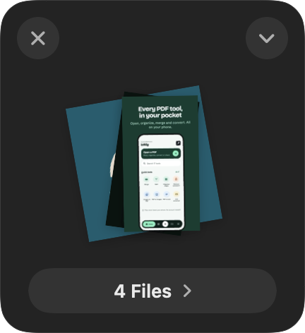
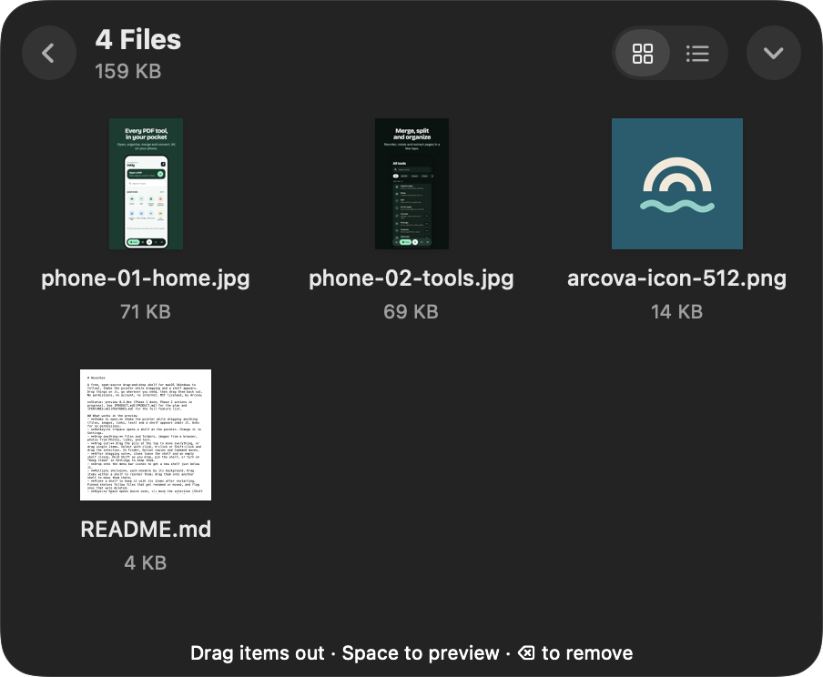
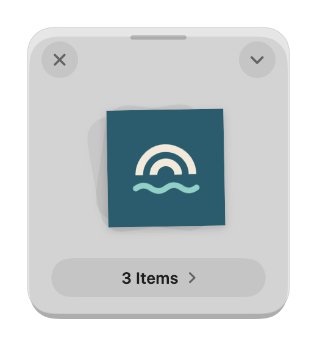
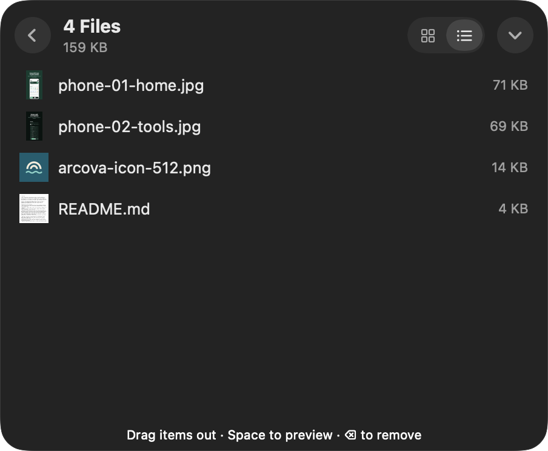
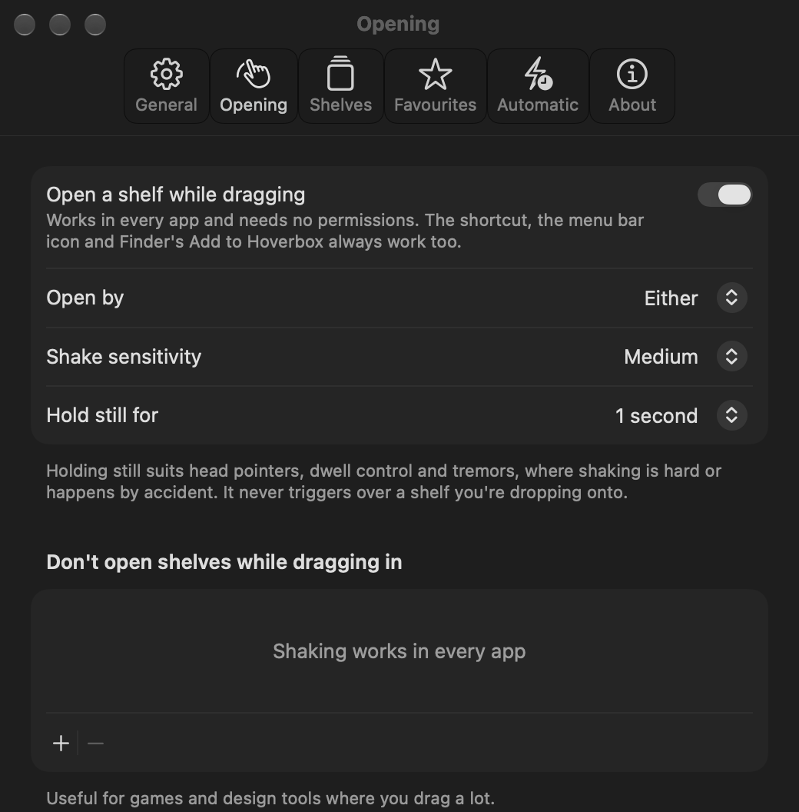

# Hoverbox

A free, open-source drag-and-drop shelf for macOS (Windows to follow). Shake the pointer while dragging and a shelf appears. Drop things on it, go wherever you need, then drag them back out. No permissions, no account, no internet. MIT licensed, by Arcova.

**Status: preview 0.4.0** (Phases 1 and 2 done). See [PRODUCT.md](PRODUCT.md) for the plan and [FEATURES.md](FEATURES.md) for the full feature list.

<p align="center">
  
  &nbsp;
  
</p>

<table>
  <tr>
    <td align="center" width="33%"><br><sub><b>Instant Actions</b> appear while you drag over a shelf</sub></td>
    <td align="center" width="33%"><br><sub><b>Light or dark</b>, glass or solid, in your colour</sub></td>
    <td align="center" width="33%"><br><sub><b>Grid or list</b>, with sizes and PDF page counts</sub></td>
  </tr>
</table>

<p align="center">
  
  <br><sub><b>Settings</b>: shake or hold still to open, sensitivity, and apps to leave alone</sub>
</p>

## Install

You need **macOS 14 Sonoma or later** (Apple silicon or Intel). There are two ways to install Hoverbox.

### Option 1: Download the app (easiest)

1. Open the [Releases page](https://github.com/aswin099/hoverbox/releases/latest) and download **`Hoverbox-macOS.zip`** from the latest release.
2. Unzip it and drag **Hoverbox.app** into your **Applications** folder.
3. Open Hoverbox. Because the preview isn't signed by Apple yet, macOS shows *"Apple could not verify Hoverbox is free of malware"*. Click **Done** (not Move to Trash).
4. Open **System Settings → Privacy & Security**, scroll down to the message about Hoverbox and click **Open Anyway**. Confirm with your password or Touch ID.
5. Open Hoverbox again. You only need to do steps 3–5 once per version.

Comfortable with Terminal? Instead of steps 3–5 you can run this once after step 2:
```bash
xattr -dr com.apple.quarantine /Applications/Hoverbox.app
```

### Option 2: Build it yourself

This needs **[Xcode](https://apps.apple.com/app/xcode/id497799835)** 26 or later (free, from the App Store; open it once after installing) and **[Homebrew](https://brew.sh)**. Run these in Terminal:

```bash
# 1. Install XcodeGen, which creates the Xcode project
brew install xcodegen

# 2. Download the code
git clone https://github.com/aswin099/hoverbox.git
cd hoverbox

# 3. Create the Xcode project
xcodegen generate

# 4. Build the app
xcodebuild -project Hoverbox.xcodeproj -scheme Hoverbox -configuration Release \
  -derivedDataPath build CODE_SIGN_IDENTITY=- build

# 5. Copy it to Applications and open it
cp -R build/Build/Products/Release/Hoverbox.app /Applications/
open /Applications/Hoverbox.app
```

An app you build yourself opens without the security warning.

## First launch

- **Hoverbox has no window or Dock icon.** It lives in the **menu bar** at the top right of your screen (a small box icon). Click it for New Shelf, your open and recently closed shelves, Pause Shake and Settings.
- **Shake the pointer while you drag something** (a file in Finder, an image in a browser, some text) and a shelf appears under it. Drop, then drag things out wherever you need them. If shaking is hard, choose *Holding the pointer still* in **Settings → Opening**.
- **Press ⌥⇧Space** (Option + Shift + Space) anywhere for a new shelf at the pointer.
- **No permission prompts.** Hoverbox doesn't need Accessibility, Input Monitoring or Screen Recording, and never connects to the internet.
- **"Hoverbox" in the Share menu:** if it doesn't appear, turn it on in **System Settings → General → Login Items & Extensions → Sharing**.
- **"Add to Hoverbox" in Finder's right-click menu** (under *Quick Actions* or *Services*): if it's missing, turn it on in **System Settings → Keyboard → Keyboard Shortcuts → Services → Files and Folders**. Its shortcut is ⇧⌘B.
- **Start Hoverbox automatically:** Settings → General → *Open Hoverbox at login*.

## Update

Quit Hoverbox from its menu bar icon, replace **Hoverbox.app** in Applications with the new version (for Option 2, run `git pull` in the `hoverbox` folder and repeat steps 3–5), then open it. Pinned shelves, recently closed shelves and your settings are kept.

## Uninstall

1. Quit Hoverbox from its menu bar icon. If you turned on *Open Hoverbox at login*, turn it off first.
2. Delete **Hoverbox.app** from Applications. This also removes its Share menu entry and Finder action.
3. To also delete pinned shelves, recently closed shelves and any copies Hoverbox kept, delete the folder `~/Library/Application Support/Hoverbox`.
4. Optional: remove its settings with `defaults delete com.arcova.hoverbox` in Terminal.

## What works in the preview
- **Two faces:** a shelf appears compact, as a pile of thumbnails with its name. Drag the pile to take everything; click it or the name to grow it into the full view, a grid or list with names, sizes and PDF page counts. The chevron opens shelf options (pin, name, show all) and the actions.
- **Shake to open:** shake the pointer while dragging anything (files, images, links, text) and a shelf appears under it. Asks for no permissions.
- **Hold still to open:** instead of (or as well as) shaking, pause the pointer during a drag for 0.5–2 s (Settings › Opening). Made for head pointers, dwell control and tremors; it never triggers over a shelf you're dropping onto.
- **No dragging needed:** in Finder, right-click › **Add to Hoverbox** (or press ⇧⌘B; change it in System Settings › Keyboard › Keyboard Shortcuts › Services). Or copy files with ⌘C and press ⌘V on a shelf. ⌘C on a shelf copies the selected items.
- **Share menu:** "Hoverbox" appears in every app's Share menu (files, images, links, text). If it doesn't, turn it on in System Settings › General › Login Items & Extensions › Sharing.
- **Shortcut gestures:** press New Shelf twice quickly to put the clipboard on the new shelf; hold it to bring back what you last dragged out. ⌥⇧Tab switches between shelves. Optional shortcuts for ZIP, Extract Text, Compress Images, Resize 50%, AirDrop and Share work on the shelf you used last (Settings › Shortcuts).
- **Copy mode** (Settings › Shelves): keep copies instead of references, so originals are never moved or changed.
- **Look and placement:** light, dark or system appearance; regular or large expanded size; shelves from the shortcut or Finder can open at the pointer, top-right or centre; optionally open straight into "all items".
- **Low-disk check:** actions and copy mode stop with a message when less than 500 MB is free.
- **VoiceOver:** shelves announce when they open or close, when items arrive and when actions finish.
- **Hotkey:** ⌥⇧Space opens a shelf at the pointer. Change it in Settings.
- **Drop anything:** files and folders, images from a browser, photos from Photos, links, and text.
- **Drag out:** drag the pile at the top to move everything, or drag single items. Select with click, ⌘-click or Shift-click and drag the selection. In Finder, Option copies and Command moves.
- **After dragging out**, items leave the shelf and an empty shelf closes. Hold Shift as you drop, pin the shelf, or turn on "Keep items" in Settings to keep them.
- **Drop onto the menu bar icon** to get a new shelf just below it.
- **Multiple shelves.** Move one by dragging any empty part of it (the grabber bar at the top shows where); double-click an empty part to name it. Drag items within a shelf to reorder them; drag them onto another shelf to move them there.
- **Colours:** give a shelf a colour from the chevron menu; it tints the grabber and shows in the menu bar list.
- **Dock to an edge:** push a shelf against the left or right edge of the screen and it tucks away as a slim tab. Click the tab, or drag files over it, to bring it back.
- **Recently Closed:** the menu bar keeps the last 10 shelves you closed with things on them; pick one to reopen it.
- **Favourites:** add folders and apps in Settings. While you drag over a shelf they appear as drop targets under the Instant Actions (folders get a copy, ⌘ moves; apps open the files), and in the shelf menu as Copy To, Move To and Open With.
- **Automatic shelves:** new screenshots (recognised by the marker macOS writes on them, in any language) and new files in watched folders such as Downloads appear on a named shelf in the top-right corner, without taking focus. Unfinished downloads are ignored.
- **Pin** a shelf to keep it with its items after restarting. Pinned shelves follow files that get renamed or moved, and flag ones that were deleted.
- **Keys:** Space opens Quick Look, ↑/↓ move the selection (Shift extends it), Return opens, ⌫ removes, ⌘A selects all, Esc clears the selection. Double-click opens an item; double-click the title to rename the shelf.
- **Right-click** an item: Open, Quick Look, Show in Finder, Rename… (renames the file itself), Copy, Remove.
- **Actions** (the ⚡ button acts on the selection, or the whole shelf; also in the right-click menu): Share, AirDrop, Compress to ZIP, Unzip, Resize Images (25/50/75% or longest side 800–3840 px), Convert Images To PNG/JPEG/HEIC/TIFF, Compress Images (keeps a result only if it's smaller), Extract Text (images and PDFs, copied to the clipboard). Results are new files added to the shelf and selected; originals are never changed. Image metadata such as location isn't copied into results.
- **Instant Actions:** while you drag over a shelf, a strip appears at the bottom: drop on AirDrop, Share, ZIP or Text to run it straight away without collecting first.
- **Accessibility:** VoiceOver labels on every control, full keyboard use, and Reduce Motion respected.
- **Menu bar:** new shelf, open shelves, close unpinned shelves, pause shake, Settings.
- **Settings:** shelf background from glass to solid (live), shake on/off and sensitivity, hotkey, keep after drag-out, apps where shaking is ignored, launch at login.
- **Links:** `open "hoverbox://new"` opens a shelf; `open "hoverbox://add?path=/path/to/file"` adds files to the newest shelf.

## How shake works without permissions
- macOS needs the Accessibility permission only for watching *keys*, not the mouse. Hoverbox watches for a left mouse-down in any app, then checks the pointer 60 times a second only while the button is held, so it does nothing while idle.
- It counts a drag only when the system drag pasteboard changes, which happens for a real drag but not for selecting text or moving a window.
- The shelf is an ordinary drop target, so macOS hands it the drop directly.

## Development
Needs macOS 14+, Xcode 26 or later and XcodeGen.

```sh
brew install xcodegen
xcodegen generate
open Hoverbox.xcodeproj
```

Run the core tests:

```sh
swift test --package-path Packages/HoverboxCore
```

## Layout
- `Packages/HoverboxCore`: logic with no AppKit (shake detector, shelf model, archive, rules), unit-tested.
- `App/`: the macOS app (menu bar, shelf panels, drag in and out, Quick Look, settings).
- Pinned shelves are saved in `~/Library/Application Support/Hoverbox/shelves.json` (paths and bookmarks only). Images or promised files that arrive as data are kept in `Drops/` there until their shelf closes.

## Credits
KeyboardShortcuts by Sindre Sorhus (MIT). The idea of making the shelf a plain drop target came from reading the architecture notes of [Perch](https://github.com/hausfold/perch) (MIT); no code was copied.
